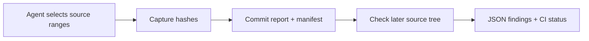

<div align="center">


[](https://github.com/XingCEO/evidence-link-audit/actions/workflows/ci.yml)

[](LICENSE)


**Keep a coding agent's file-and-line evidence attached to the code it actually reviewed.**

Capture selected source ranges. Commit the manifest with your report. Catch changed, missing, or shifted evidence in CI.

[Try the workflow](#quickstart) · [Evidence contract](#evidence-contract) · [Failure modes](#reports-and-exit-codes) · [Contribute](CONTRIBUTING.md)

</div>

## The problem

A review says “cache misses return `None`” and cites `src/cache.py:1–3`. Later, the implementation changes to dictionary indexing, which raises on a miss. The path still exists and the line numbers still look plausible. The report's evidence is now stale.

Evidence Link Audit records a SHA-256 digest of the selected lines, then compares that digest against a later checkout. It works on real UTF-8 source files, has no runtime dependencies, and runs no source code or network requests.



## Quickstart

Requires Python 3.11+. Install from the checkout; this project does not claim a PyPI release.

```bash
git clone https://github.com/XingCEO/evidence-link-audit.git
cd evidence-link-audit
python3 -m venv .venv
. .venv/bin/activate
python -m pip install .
```

Capture the committed synthetic source example:

```bash
evidence-link-audit \
  --repo examples/repository \
  --evidence examples/evidence.json \
  --capture > evidence.lock.json
```

Check that manifest against the current source tree:

```bash
evidence-link-audit \
  --repo examples/repository \
  --evidence evidence.lock.json \
  --check
```

The check prints `"valid": true` and exits `0`. To see a complete clean → changed → rejected demonstration in a disposable directory:

```bash
python examples/reproduce_stale.py
```

```json
{
  "fresh_check_exit": 0,
  "stale_check_exit": 1,
  "issues": [
    "content_changed",
    "snippet_missing"
  ]
}
```

The demo copies [this source fixture](examples/repository/src/cache.py), captures its evidence, changes the lookup behavior, and invokes the installed CLI again. Your checkout is unchanged.

## Use it with a coding agent

1. Ask the agent to produce a report plus explicit evidence records for the source ranges it inspected.
2. Review those selected ranges and run `--capture`. Save the successful manifest alongside the report.
3. Run `--check` against the current checkout before using or publishing the report.
4. Review a stale claim and update its ranges or wording. Run `--capture` deliberately to refresh its hashes.

Capture is a baseline operation: it refreshes any old hashes in its input. Check requires a hash on **every** record and never silently creates a baseline. Optional literal snippets remain checked during capture, so a missing expected snippet prevents creation of a manifest.

A hash matching the current lines establishes that those lines have not changed under the normalization below. A reviewer still decides whether they support the claim.

## Evidence contract

Evidence paths are relative to `--repo`. The JSON file supplied to `--evidence` is relative to the current working directory, or use `-` to read JSON from stdin.

```json
{
  "evidence": [
    {
      "id": "cache-miss-behavior",
      "path": "src/cache.py",
      "start": 1,
      "end": 3,
      "contains": "return cache.get(key)"
    }
  ]
}
```

| Field | Contract |
| --- | --- |
| `id` | Nonempty string, unique within a nonempty evidence array. |
| `path` | Canonical relative POSIX path, such as `src/cache.py`. No absolute paths, backslashes, `.`/`..` components, redundant separators, or Windows drive prefixes. |
| `start` | One-based integer line number. Booleans are rejected. |
| `end` | Inclusive integer end line; defaults to `start`. The entire range must exist. |
| `contains` | Optional literal substring of the selected excerpt, case-sensitive. |
| `sha256` | Required by check, produced by capture: 64 lowercase hexadecimal characters. |

Capture emits `{"schema_version": 1, "evidence": [...]}` with explicit end lines and current hashes. Records retain their input order; JSON object keys are sorted. There are no timestamps, absolute root paths, source excerpts, or random identifiers in the report or manifest. Unknown record fields, duplicate ids, duplicate JSON keys, and unsupported schema versions are rejected.

Browse the committed [captured manifest](examples/evidence.lock.json) and [passing check report](examples/check-output.json) for the example source tree.

**Line and hash semantics:** files are decoded as UTF-8. CRLF becomes LF; a bare CR and Unicode line separator remain content. Lines split on LF. One final line terminator does not create an extra line; an empty file has no citable lines. Selected lines join with LF with no terminator after the last selected line, then are encoded as UTF-8 and hashed. A selected final blank line is valid. CRLF/LF conversions and a changed final file terminator alone do not invalidate evidence.

Only the selected range is hashed. An edit elsewhere can preserve validity; inserting lines before a citation normally changes the selected content and makes it stale. Repeated identical text can still match at the old location.

## Reports and exit codes

Check returns a deterministic JSON report. For a modified source range, an entry includes:

```json
{
  "id": "cache-miss-behavior",
  "path": "src/cache.py",
  "start": 1,
  "end": 3,
  "expected_sha256": "<captured digest>",
  "sha256": "<current digest>",
  "issues": ["content_changed", "snippet_missing"],
  "valid": false
}
```

The two digest placeholders above illustrate the fields; real reports contain 64-character hexadecimal digests. The top level contains `checked`, `evidence`, and `valid`.

| Exit | Meaning |
| --- | --- |
| `0` | Check passed, capture succeeded, or legacy snapshot analysis completed. |
| `1` | `--check` found one or more invalid evidence records. |
| `2` | Invalid CLI/JSON/schema/root, unreadable manifest, or a capture that cannot establish valid evidence. |

Failed captures print the findings report to stdout with exit `2`; they do not emit a reusable manifest. Other input errors print a concise message to stderr and no JSON to stdout. Check findings go to stdout with exit `1`.

Findings are `content_changed`, `snippet_missing`, `missing_digest`, `missing_file`, `invalid_line_range`, `outside_repository`, `not_regular_file`, `invalid_utf8`, or `unreadable_file`. Source read failures are findings so one unavailable file does not suppress the remaining records.

For CI, **capture once during review and commit the resulting manifest**. Run only the check in subsequent jobs:

```yaml
- run: python -m pip install ./tools/evidence-link-audit
- run: evidence-link-audit --repo . --evidence reports/evidence.lock.json --check
```

Adapt the install path to your checkout. Capturing on every CI run would replace the baseline and defeat the comparison.

## Python API and snapshot compatibility

```python
from evidence_link_audit import audit_repository, capture_repository

manifest = capture_repository("checkout", {
    "evidence": [{"id": "lookup", "path": "src/cache.py", "start": 1, "end": 3}]
})
report = audit_repository("checkout", manifest)  # Requires captured hashes by default.
assert report["valid"]
```

`capture_repository` raises `CaptureError` on failed evidence; its `.report` contains findings. Malformed input raises `ValueError`. `audit_repository(..., require_hashes=False)` is available for a deliberate range/snippet-only inspection.

The original `analyze({"files": {"path": "text"}, "evidence": [...]})` API and `evidence-link-audit examples/input.json` remain available for supplied snapshots. Snapshot CLI mode preserves exit `0` for completed analysis, including findings; inspect its `valid` field. Use native `--check` for a CI gate.

## Validation

```bash
python -m unittest discover -v
python examples/reproduce_stale.py
```

Tests exercise real temporary source trees, capture/check roundtrips, changed and removed files, line shifts, snippet failures, CRLF, empty/blank lines, UTF-8 errors, malformed manifests, path traversal, external symlinks, and CLI exit behavior. CI installs the console entry point, runs native capture/check and stale-source smoke tests, and checks Python 3.11 and 3.13.

## Boundaries

This tool verifies explicit source evidence, not the truth or completeness of a report. It does not parse Markdown links, relocate moved citations, track Git history, or prove that behavior elsewhere remains unchanged. A Git commit permalink remains useful for preserving the original context; this tool checks evidence against a chosen later tree.

Resolved paths must remain inside the repository root. In-root symlinks are supported; external targets are rejected without reading their contents. Source trees must be trusted and remain stable during one invocation: path resolution and file reads are not an atomic snapshot or a sandbox against a hostile process racing file replacements. Each referenced path is read once per invocation.

Inputs contain explicit paths and optional snippets; reports contain paths, ids, and hashes. Choose the appropriate place to store your manifests. Source files are never modified by the analyzer.

## References and contributing

- [GitHub permanent links](https://docs.github.com/en/repositories/working-with-files/using-files/getting-permanent-links-to-files)
- [SHA-256 specification](https://csrc.nist.gov/projects/hash-functions)
- [Contribution guide](CONTRIBUTING.md)

Independent implementation using Python's standard library. Small synthetic reproductions and precise expected behavior are welcome.

[MIT](LICENSE) © 2026 XingCEO.
