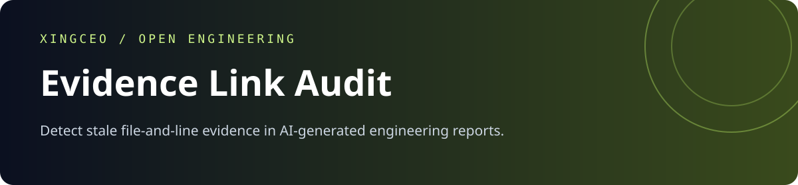
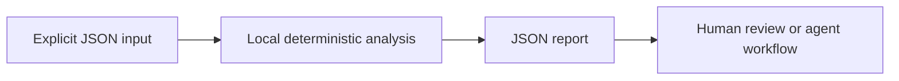

<div align="center">



[](https://github.com/XingCEO/evidence-link-audit/actions/workflows/ci.yml)

[](LICENSE)


**Detect stale file-and-line evidence in AI-generated engineering reports.**

[Try it](#quickstart) · [Input contract](#input-contract) · [Example report](examples/output.json) · [Contribute](CONTRIBUTING.md)

</div>

## The problem

An agent report can cite a real path and plausible line number even after the cited code has changed. Existence checks alone do not establish whether the evidence still matches.

## How it works

Check explicit evidence records against a supplied snapshot of text files. Validate one-based inclusive ranges, compare optional SHA-256 digests of normalized excerpts and verify literal expected snippets. Every result carries the current excerpt hash so a reviewer can refresh evidence deliberately.



## Quickstart

Requires Python 3.11 or later. The analyzer has **no runtime dependencies**, makes no network requests and runs no shell commands. Domain-specific interpretation (such as SQL rehearsal) is described below.

```bash
git clone https://github.com/XingCEO/evidence-link-audit.git
cd evidence-link-audit
python3 -m evidence_link_audit examples/input.json
```

Optional installation into an isolated environment:

```bash
python3 -m venv .venv
. .venv/bin/activate
python -m pip install .
evidence-link-audit examples/input.json
```

The package is installed from this checkout; no PyPI publication is claimed.

## Input contract

Use [the complete example](examples/input.json) as a starting point. Paths and strings in JSON are data unless the contract explicitly says they refer to local files.

| Field | Meaning |
| --- | --- |
| `files` | Map of repository-relative paths to exact text snapshots. |
| `evidence` | Records with unique id, path, one-based start/end, optional contains and sha256. |

## Example result

Generated by running the committed example:

```json
{
  "checked": 1,
  "evidence": [
    {
      "end": 2,
      "id": "cache-lookup",
      "issues": [
        "snippet_missing"
      ],
      "path": "src/cache.py",
      "sha256": "127a24d074ab0be4e143f59eb22046ba1613e5a3aff4f86e146e3954cf8e0947",
      "start": 1,
      "valid": false
    }
  ],
  "valid": false
}
```

## Use from another tool

```python
import json
from evidence_link_audit import analyze

with open("examples/input.json", encoding="utf-8") as stream:
    report = analyze(json.load(stream))
```

`analyze(data)` returns a JSON-serializable dictionary. The CLI accepts `-` for stdin, writes reports to stdout and input errors to stderr. Exit `0` means analysis completed, including reports containing findings; exit `2` means invalid input or an unreadable file. Gate CI on the report's documented fields, rather than assuming exit `0` means no findings. The JSON report is a v0.1 interface and may evolve before 1.0.

## Validation

```bash
python3 -m unittest discover -v
```

Tests cover the example, malformed CLI input, and the domain-specific boundary cases in [tests/test_core.py](tests/test_core.py). CI also installs the package and runs its console entry point on Python 3.11 and 3.13. Test success demonstrates these cases; it is not evidence of production deployment.

## Scope and limits

This checks supplied records and snapshots, not the truth of a claim or completeness of a report. No Markdown parser or automatic repository crawler is included. Lines normalize CRLF through splitlines and join with LF; trailing newline is excluded from excerpt hashes.

This is a focused experimental first release. Review findings before changing production systems. Inputs and reports may contain your own source or metadata; keep them in an appropriate local workspace.

## Related work and references

- [GitHub permanent links](https://docs.github.com/en/repositories/working-with-files/using-files/getting-permanent-links-to-files)
- [SHA-256](https://csrc.nist.gov/projects/hash-functions)

These projects and specifications inform the problem space. This repository is an independent implementation; it does not claim to replace the referenced systems or to have invented the underlying techniques.

## Contributing

A small real-world fixture with expected behavior is the most useful contribution. See [CONTRIBUTING.md](CONTRIBUTING.md). Please remove private data before filing an issue.

## License

[MIT](LICENSE) © 2026 XingCEO.
